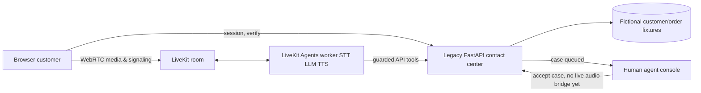
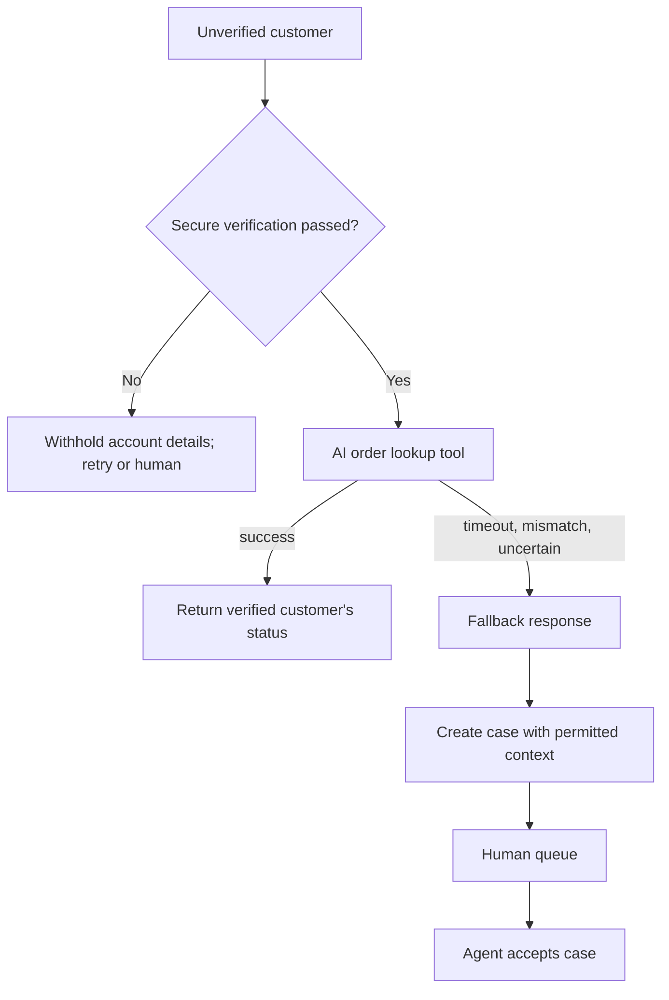

# Architecture / workflows

## POC: caller → fulfillment


## Media versus signaling
```mermaid
sequenceDiagram
 participant B as Browser
 participant A as Backend token service
 participant L as LiveKit media room
 participant W as Voice worker
 B->>A: Create session, request room token
 A-->>B: Room-scoped token
 B->>L: WSS signaling and WebRTC audio
 L->>W: Published customer media
 W->>W: STT → LLM/tool → TTS; interruption handling via framework
 W-->>L: Synthesized audio
 L-->>B: Playback via WebRTC track
```

## CRM lookup, handoff and failure recovery


Operator dashboard: browser → privileged API → queue/case/event state. All events are simulated or real browser events, never claimed PSTN. Pilot/production views on their own branches.
