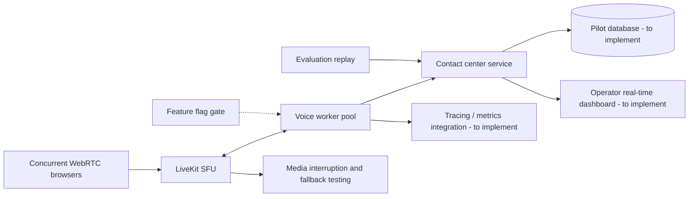

# Pilot architecture

Pilot branch adds replay/load scaffolding and evidence requirements. Durable database, real-time streaming operator views, LiveKit concurrency measurements and feature-flag backend remain engineering work. Source artifacts must not be confused with a signed-off pilot.
