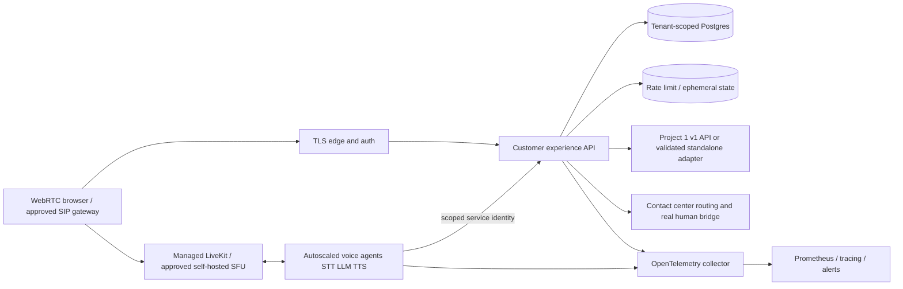
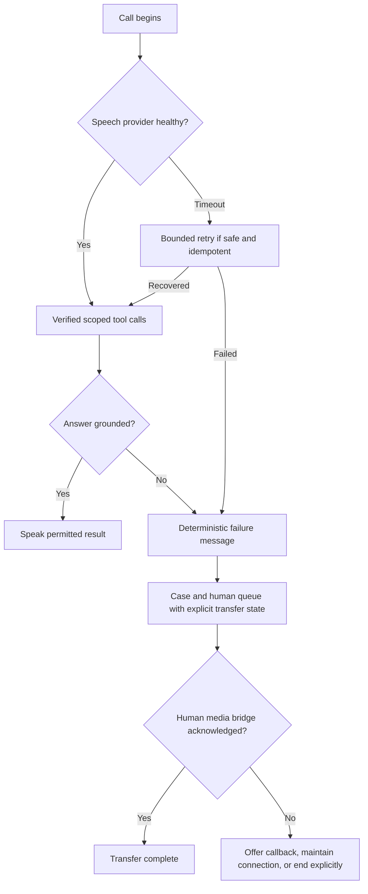

# Production target architecture (not deployed)

## User to fulfillment and media/signaling

## Failure recovery

Human audio bridging, enterprise identity, persistent state and distributed tracing are **target state only** and not present in the POC code. Do not present these drawings as deployed infrastructure.
